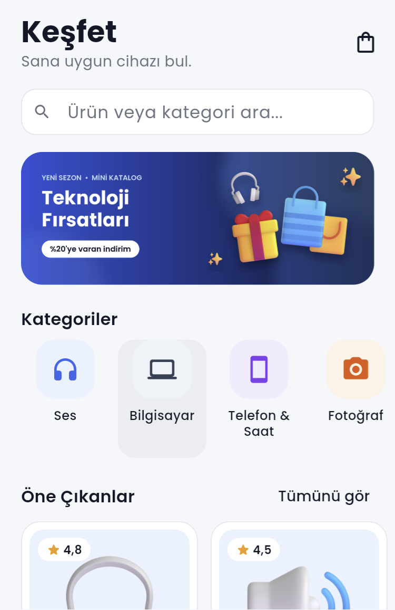
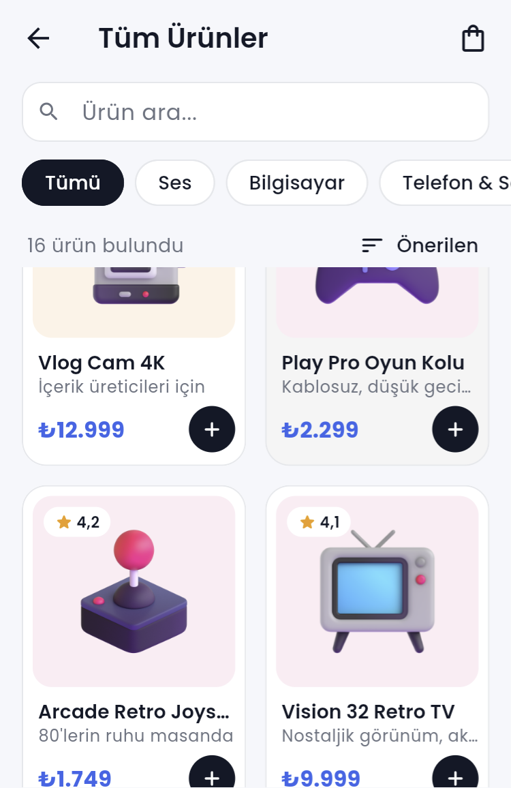
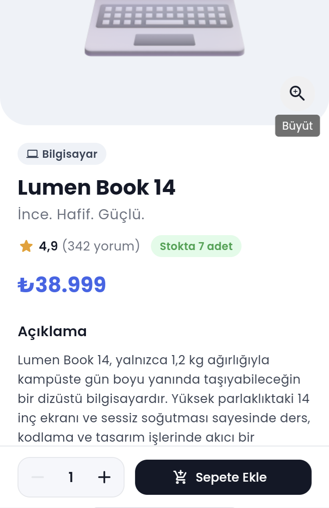
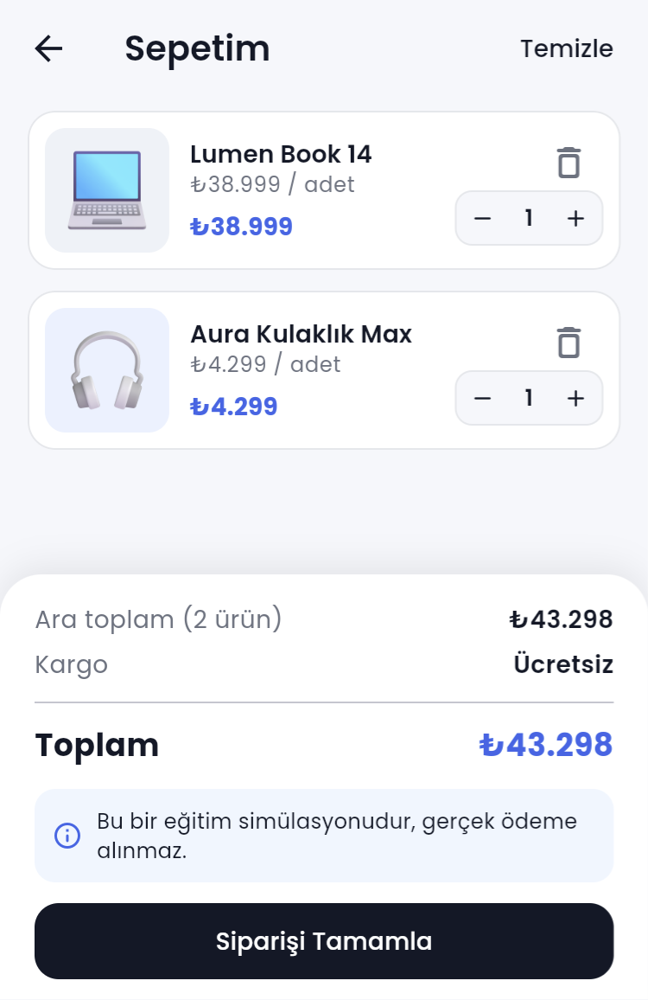
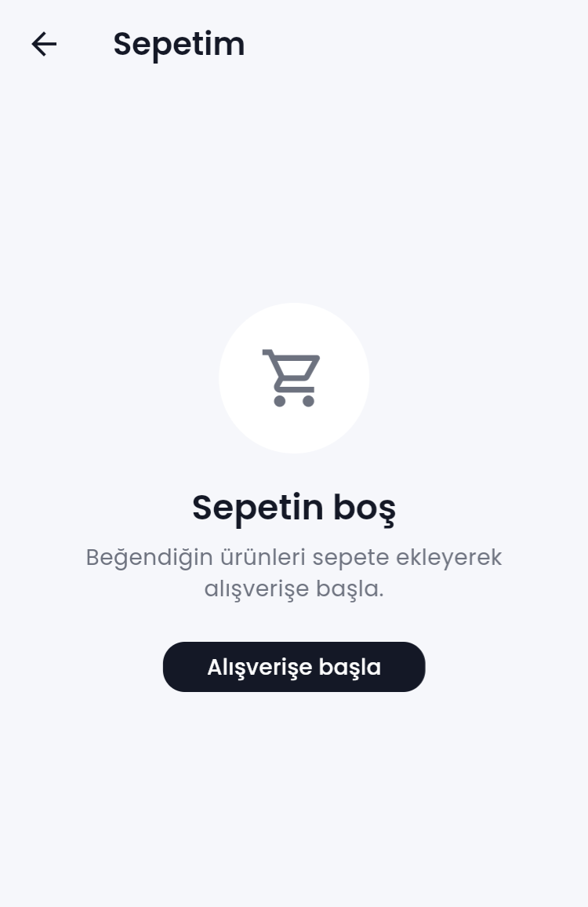
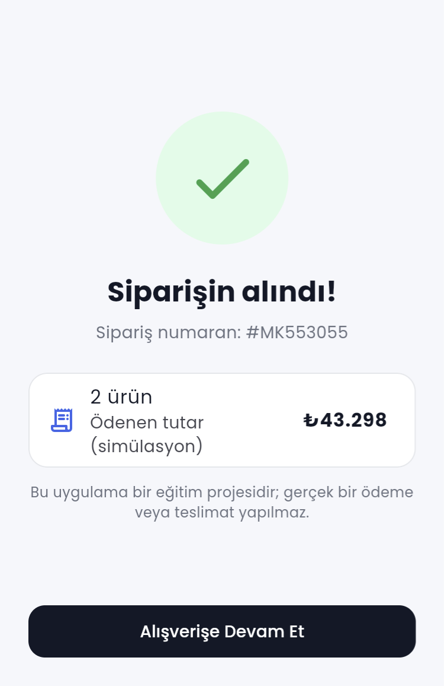

# Mini Katalog Uygulaması 🛍️

Flutter Günlük Eğitim kapsamında geliştirilen, **ana sayfa – ürün listesi – ürün detayı – sepet** yapısına sahip mini bir ürün kataloğu uygulaması.

## Proje Adı

**Mini Katalog** (`mini_katalog`)

## Kısa Açıklama

Kullanıcı ana sayfada (Keşfet) banner, kategoriler, öne çıkan ve popüler ürünleri görür; ürün arayabilir, kategoriye göre filtreleyebilir ve fiyata/puana göre sıralayabilir. Bir ürüne dokununca detay sayfası açılır: açıklama, özellikler, renk seçenekleri ve stok bilgisi gösterilir. Adet seçilerek ürün sepete eklenir; sepet rozeti anında güncellenir. Sepette adet artırılıp azaltılabilir, ürün silinebilir, ara toplam / kargo / toplam görülür ve sipariş **simülasyon olarak** tamamlanır.

Ürün verileri, eğitimdeki *JSON simülasyonu* mantığıyla `assets/data/products.json` dosyasından okunur; internet bağlantısı gerekmez.

## Kullanılan Flutter Sürümü

| Araç | Sürüm |
| --- | --- |
| Flutter | **3.47.7** (stable) |
| Dart | 3.13.5 |
| Android Gradle Plugin / Gradle / Kotlin | 9.1.0 / 9.3.1 / 2.4.0 |

- Android ve web klasörleri Flutter 3.47.7'nin `flutter create` şablonlarından oluşturuldu.
- Eğitim kuralı gereği **harici paket kullanılmadı**; yalnızca Flutter SDK (`material.dart`).

## Çalıştırma Adımları

1. Flutter'ın kurulu olduğunu ve sürümünü kontrol edin:
   ```bash
   flutter --version
   flutter doctor
   ```
2. Projeyi klonlayın ve klasöre girin:
   ```bash
   git clone https://github.com/belinaybirkan/mini_katalog.git
   cd mini_katalog
   ```
3. Bağımlılıkları indirin:
   ```bash
   flutter pub get
   ```
4. Android Studio → **Device Manager** üzerinden bir emülatör başlatın (veya USB hata ayıklaması açık bir Android telefon bağlayın) ve cihazın görüldüğünü kontrol edin:
   ```bash
   flutter devices
   ```
5. Uygulamayı çalıştırın:
   ```bash
   flutter run
   ```
6. (İsteğe bağlı) Testleri ve kod analizini çalıştırın:
   ```bash
   flutter test
   flutter analyze
   ```

> Emülatör yoksa hızlı önizleme için: `flutter run -d chrome`

## Ekran Görüntüleri

| Ana Sayfa | Ürün Listesi | Ürün Detayı |
| --- | --- | --- |
|  |  |  |

| Sepet | Boş Sepet | Sipariş Onayı |
| --- | --- | --- |
|  |  |  |

## Özellikler

- **Ana sayfa (Keşfet):** arama kutusu, banner, kategori listesi, öne çıkan ürünler (yatay liste), popüler ürünler (GridView), sepet rozeti.
- **Ürün listesi:** GridView ile kart tabanlı tasarım, canlı arama, kategori filtresi (ChoiceChip), sıralama (alt sayfa / bottom sheet).
- **Türkçe karakter duyarsız arama:** "hoparlor" yazınca "Hoparlör" bulunur.
- **Ürün detayı:** büyük görsel (dokununca tam ekran + yakınlaştırma), açıklama, özellik kutucukları, renkler, stok, puan, adet seçici.
- **Sepet (simülasyon):** ekle / adet artır-azalt / sil / temizle, ara toplam, kargo (₺1.000 üzeri ücretsiz), toplam, sipariş onay sayfası.
- **Durum yönetimi:** `ChangeNotifier` + `InheritedNotifier`; sepete eklenen ürün tüm sayfalardaki rozeti anında günceller.
- Yükleniyor / hata / boş durum ekranları, Material 3 teması ve Poppins yazı tipi.

## Eğitim Konularının Projedeki Karşılığı

| Eğitim konusu | Projedeki karşılığı |
| --- | --- |
| Stateless / Stateful widget | `ProductCard`, `CartScreen` (Stateless) · `HomeScreen`, `ProductListScreen`, `ProductDetailScreen` (Stateful) |
| Text, Container, Row, Column | Tüm ekranlar; ör. `widgets/product_card.dart` |
| Padding, Margin, Expanded, Align | `ProductCard` (margin), `CartItemTile` (Expanded), `_CartSummary` (Align) |
| Card, ListTile, butonlar | `ProductCard`, `CartItemTile` (Card) · sıralama ve sipariş onayı (ListTile) · `FilledButton`, `OutlinedButton`, `TextButton`, `IconButton` |
| Widget ağacı ve context | `CartScope.of(context)`, `Theme.of(context)`, `ScaffoldMessenger.of(context)` |
| Navigator.push / pop | Görsel önizleme ve sipariş onay sayfası `Navigator.push` + `MaterialPageRoute` ile açılır, `Navigator.pop` / `popUntil` ile kapanır |
| Route, MaterialPageRoute, Named Routes | `routes/app_routes.dart` → `routes` haritası + `onGenerateRoute` + `onUnknownRoute` |
| Route Arguments | Detaya `Product`, ürün listesine `ProductListArgs` (ürünler, başlık, kategori, arama metni) gönderilir |
| Model sınıfı, fromJson / toJson | `models/product.dart`, `models/product_spec.dart`, `models/cart_item.dart` |
| JSON simülasyonu | `assets/data/products.json` + `data/product_repository.dart` (`rootBundle` + `jsonDecode` + `FutureBuilder`) |
| ListView.builder | Kategoriler ve öne çıkanlar (yatay), sepet listesi, kategori filtreleri |
| GridView ile ürün kartları | Ana sayfadaki popüler ürünler ve ürün listesi (`GridView.builder`) |
| Görsel ekleme, Image.asset | `widgets/product_image.dart`, ana sayfa banner'ı |
| Arama ve filtreleme | `utils/product_filter.dart` |
| Sepet butonu ile state güncelleme | `state/cart_controller.dart` (`ChangeNotifier`) + `state/cart_scope.dart` (`InheritedNotifier`) |
| Basit UI teması | `theme/app_theme.dart`, `theme/app_colors.dart` |
| Asset yönetimi | `pubspec.yaml` → görseller, JSON, yazı tipi, lisans dosyaları |

## Proje Yapısı

```
lib/
├── main.dart                     # Giriş noktası (runApp + lisans kaydı)
├── app.dart                      # MaterialApp, tema, route'lar, CartScope
├── data/
│   └── product_repository.dart   # JSON'dan ürün okuma (rootBundle)
├── models/
│   ├── product.dart              # Ürün modeli (fromJson / toJson)
│   ├── product_spec.dart         # Ürün özelliği modeli
│   └── cart_item.dart            # Sepet satırı modeli
├── routes/
│   └── app_routes.dart           # Named routes, ProductListArgs, AppRouter
├── state/
│   ├── cart_controller.dart      # Sepet durumu (ChangeNotifier)
│   └── cart_scope.dart           # Sepeti sayfalara dağıtan InheritedNotifier
├── screens/
│   ├── home/home_screen.dart                     # Ana sayfa (Keşfet)
│   ├── product_list/product_list_screen.dart     # Ürün listesi (GridView)
│   ├── product_detail/product_detail_screen.dart # Ürün detayı
│   ├── product_detail/image_preview_screen.dart  # Tam ekran görsel
│   ├── cart/cart_screen.dart                     # Sepet
│   ├── cart/order_success_screen.dart            # Sipariş onayı
│   └── route_error_screen.dart                   # Hatalı route sayfası
├── theme/                        # Renkler ve tema
├── utils/                        # Fiyat biçimlendirme, arama/filtreleme, kategori stilleri
└── widgets/                      # Tekrar kullanılan bileşenler (kart, rozet, adet seçici...)
assets/
├── data/products.json            # 16 ürün (JSON simülasyonu)
├── images/banner.png             # Ana sayfa banner'ı
├── images/products/              # Ürün görselleri
├── fonts/                        # Poppins yazı tipi
└── licenses/                     # Görsel ve yazı tipi lisansları
test/                             # Birim ve widget testleri
screenshots/                      # README'deki ekran görüntüleri
```

## Veri ve Görseller Hakkında

- Ürünler ve fiyatlar **eğitim amaçlı, hayali** verilerdir; gerçek bir e-ticaret altyapısını temsil etmez.
- Yönergede örnek olarak verilen uzak API'ler (`wantapi.com/products.php`, Fake Store API, DummyJSON) yerine, *harici paket kullanılmaması* kuralı ve internetsiz çalışabilmesi için **yerel JSON simülasyonu** tercih edildi. JSON biçimi DummyJSON'a benzer (`{"total": 16, "products": [...]}`). Uzak bir servise geçmek için yalnızca `ProductRepository.loadProducts()` metodunu değiştirmek yeterlidir.
- Ürün görselleri: [Microsoft Fluent Emoji](https://github.com/microsoft/fluentui-emoji) (MIT Lisansı). Banner ve uygulama ikonu bu görsellerle bu proje için hazırlandı.
- Yazı tipi: [Poppins](https://github.com/google/fonts/tree/main/ofl/poppins) (SIL Open Font License 1.1).
- Ayrıntılar: [THIRD_PARTY_NOTICES.md](THIRD_PARTY_NOTICES.md)

## Testler

`flutter test` komutu şunları doğrular:

- Model dönüşümleri (`fromJson` / `toJson`) ve JSON verisinin tutarlılığı — `test/models_test.dart`
- Arama, filtreleme, sıralama ve fiyat biçimlendirme — `test/product_filter_test.dart`
- Sepet mantığı (ekleme, azaltma, silme, kargo, toplam) — `test/cart_controller_test.dart`
- Ekran akışları (ana sayfa → detay → sepete ekleme → sepet → sipariş, arama ve filtre) — `test/widget_test.dart`
